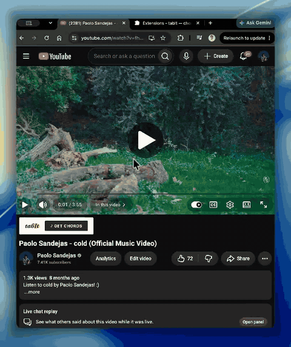
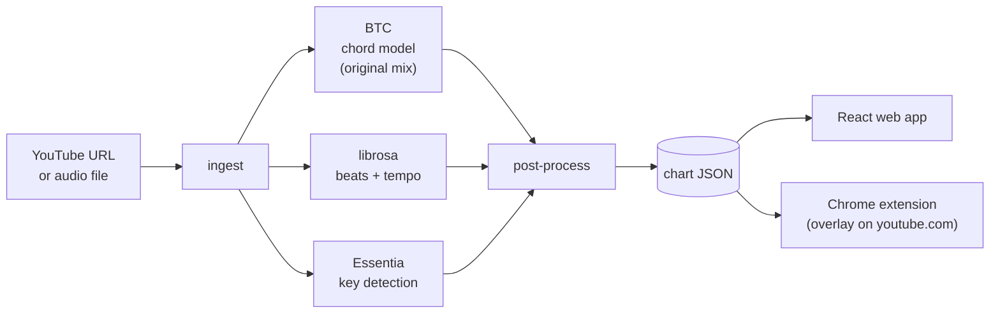

<div align="center">

<picture>
  <source media="(prefers-color-scheme: dark)" srcset="docs/assets/logo-dark.svg">
  
</picture>

**paste a song, follow the chords, play along**

Turn any song into a synced, play-along guitar chord sheet, embedded right under the
YouTube video you're watching: chords, key, and suggested scales,
followed karaoke-style as the music plays.

[](https://github.com/paolosand/tabIt/actions/workflows/ci.yml)      

</div>



<p align="center"><sub>A real recording on youtube.com. Click the "♪ Get chords" bar under the video you're already watching, and the bar walks through the pipeline live: fetch audio, find chords, build chart (recorded on the older 0.3 pipeline, which also had an instrument-separation step and took about 36 seconds in real time; sped up here). Then the beat ribbon embeds itself, sweeping beat by beat with the next chord always in sight.</sub></p>

## Why this exists

It started with a familiar moment: you're watching a video, the song grabs you, and you
want to play along right now. tabIt lives inside that moment. Click the "♪ Get chords"
bar under any YouTube video and the chords embed themselves right there, synced to
playback, guitar still in hand.

The other half is coverage. Chord sites can only offer what someone has transcribed,
and plenty of what you'd love to play has no tab anywhere: an unreleased song, a live
version, a friend's demo, your own recordings. tabIt detects the chords from the audio
itself, so you can play along to practically anything.

- **Lives under the video.** The Chrome extension expands into a beat ribbon: one cell
  per detected beat, an amber sweep on the moment, the next change always visible before
  it arrives. Ad-aware (it pauses with the ad), SPA-navigation safe, and the full paper
  sheet is one click away.
- **Karaoke-style following.** The current chord is always obvious at a glance; the next
  chord is flagged before it arrives, so your hands are ready.
- **Honest confidence.** Chord detection is imperfect (state of the art is ~72% on
  7th chords; human experts only agree ~54% on complex ones). Low-confidence chords are
  visibly softer with a dotted underline, never hidden. Click any chord to correct it;
  edits persist locally.
- **Practice-friendly.** Key, tempo, and scale chips at the top; one-tap transpose;
  auto-scroll that keeps the current line in view.
- **Fast, and light.** Analysis of a ~3.5-minute song takes a few seconds of compute
  on an Apple-Silicon Mac (measured: 1 to 5 s for the engine itself on 15 songs, plus the
  download), and the installed environment is about 1 GB (about 2 GB of disk with the download cache). The first run also fetches the
  12 MB BTC weights (the installer does this up front). While it runs, the bar shows each
  pipeline step live (download, chords, build chart) instead of a blank spinner. Every
  repeat of the same song is served instantly from a disk cache.

## How it works

Three layers share one contract: the **chart JSON**. The web app and the Chrome
extension are both just renderers of it.



Chords come from BTC alone, read straight from the original mix. For the previous
Demucs + crema pipeline (slash chords, but a ~2 GB install and ~30 s per song), see
[Older versions](#older-versions).

| Layer | What | Status |
|---|---|---|
| **MIR engine** (Python) | audio → chords + key + scales + beat grid → chart JSON | ✅ complete |
| **Web app** (FastAPI + React) | paste URL / drop file → YouTube player + synced sheet | ✅ complete |
| **Chrome extension** (MV3) | the same sheet overlaid below the player on youtube.com | ✅ complete |

## Quick start

### 1. Engine + API

Requires Python 3.11 and ffmpeg.

```bash
python3.11 -m venv .venv && source .venv/bin/activate
pip install -e ".[dev]"
```

#### Or: one-line install (macOS, beta)

Skip the manual environment entirely. The installer provisions Python 3.11
via [uv](https://docs.astral.sh/uv/), a static ffmpeg, and the chord-model weights
(about 2 GB of disk: a 1 GB environment plus the download cache; a couple of minutes), then runs the API as a
background service that starts at login. It installs
the latest tagged release, not main:

```bash
curl -fsSL https://raw.githubusercontent.com/paolosand/tabIt/main/packaging/install.sh | sh
```

When the Chrome extension is installed, it walks you through this itself: open Terminal,
paste the command (there is a **Copy command** button), press Return, and the extension
notices the helper as soon as it is running. The helper is macOS only for now. See
[`PRIVACY.md`](PRIVACY.md) for what is and is not collected (nothing is sent to the developer).

Manage it with `~/.local/bin/tabit status` / `~/.local/bin/tabit logs` / `~/.local/bin/tabit restart` /
`~/.local/bin/tabit uninstall`. Charts cache to `~/Library/Application Support/tabIt/charts`,
logs to `~/Library/Logs/tabIt/helper.log`. If the helper is off, the extension
bar says so and recovers by itself once the service is back. Rerunning the installer
upgrades in place; a 0.3.x install is rebuilt so its ~2 GB of old TensorFlow/Demucs
packages are removed (your chart cache is kept).

### 2. Chrome extension

With the API from step 1 running (already the case if you used the one-line
installer — the helper serves it as a background service):

```bash
# terminal 1: API — skip if you used the one-line installer
source .venv/bin/activate
uvicorn api.main:app --port 28224

# terminal 2: build the extension
cd extension && npm install && npm run build
```

Load `extension/dist` as an unpacked extension at `chrome://extensions`
(Developer mode → Load unpacked), then open any YouTube video and click the
"♪ Get chords" bar that appears below the player. It expands into the beat
ribbon — Shadow-DOM isolated, SPA-navigation safe, ad-aware. Verified end-to-end on
real YouTube with a headful Playwright run (cached chart renders in ~50 ms; the
marker tracks playback across chord boundaries; teardown/remount survives SPA
navigation).

### 3. Web app (optional)

The extension is the product; the web app is the dev-facing renderer of the
same chart JSON — and the only UI for **local audio files** (the extension is
YouTube-only). It shows the whole song as a songbook-style sheet, synced to
playback the same way.

```bash
# with the API running (terminal 1 above)
cd web && npm install && npm run dev   # http://localhost:5173
```

Paste a YouTube URL or drop an audio file on the landing page. Analyzed charts are
cached in `data/charts/`, keyed by video ID and engine version.

### CLI only

The engine runs standalone if you just want the chart JSON:

```bash
python -m engine.cli <youtube-url|audio-file> -o chart.json
```

## Honest about accuracy

This is a portfolio and learning project, and it doesn't pretend otherwise. On a
pilot sample of 11 Beatles songs (Isophonics hand-labeled annotations, scored
against the live YouTube pipeline with `mir_eval`), the engine (then at 0.2.1, the Demucs + crema pipeline; not yet re-run on the BTC-only 0.4.0 engine) measured **0.75
duration-weighted majmin accuracy** (0.65 sevenths) — see
[`benchmarks/results/latest.md`](benchmarks/results/latest.md) for the per-song
breakdown and [`benchmarks/README.md`](benchmarks/README.md) for the methodology.
This supersedes an earlier regression floor (0.495 weighted majmin) that came from
a **synthetic** Am→F→C→G fixture, out-of-distribution for a model trained on real
recordings. 11 songs, all from one artist/era, is a pilot, not a claim about
accuracy across genres — treat it as a directional signal, not a spec. What the
product does instead of promising precision: it shows per-chord confidence and
makes corrections one click away. A
conservatism pass also keeps the noise down: low-confidence exotic qualities
simplify to plain triads, flicker segments (under 0.5 s) merge away, and a meter detector
(chord changes land on downbeats) gives the chart real bar lines instead of assuming 4/4.
BTC emits no slash chords, so every chord's bass is its root.

## Project layout

```
engine/      Python MIR pipeline: audio in, chart JSON out
api/         FastAPI wrapper: analyze endpoints, job store, disk cache
web/         Vite + React app: player + synced chord sheet
extension/   Chrome MV3 extension: the sheet overlaid on youtube.com
data/charts/ cached analyses (videoId @ engine version)
docs/        design specs, implementation plans, progress ledger
```

## Roadmap

- [x] Extension: degraded mount fallback + live-stream guard
- [x] Extension: headful Playwright e2e against real YouTube
- [x] Animated demo in this README (screen-recorded GIF of the ribbon sweeping in time)
- [x] Live pipeline-step checklist in the extension bar while a song analyzes
- [x] macOS helper: one-line installer, launchd service, `tabit` CLI, extension offline state
- [x] Real-song accuracy floor (Isophonics-labeled pilot benchmark, 11 songs)
- [x] BTC-only engine (0.4.0): no TensorFlow, Demucs or crema; ~1 GB install instead of ~2 GB
- [ ] Song sections (verse/chorus) via allin1
- [ ] Package the extension for the Chrome Web Store (pre-built zip release as a stopgap)
- [ ] Signed menubar app — download, guided setup, no terminal (packaging Phase 2)

The full per-task build ledger lives in [docs/PROGRESS.md](docs/PROGRESS.md), with the
design specs and implementation plans in [`docs/superpowers/`](docs/superpowers/).

## Built with

| | |
|---|---|
| [BTC](https://github.com/jayg996/BTC-ISMIR19) | chord recognition (see below) |
| [PyTorch](https://pytorch.org) | runs the BTC model |
| [librosa](https://librosa.org) | beat and tempo tracking |
| [Essentia](https://essentia.upf.edu) | key detection |
| [mir_eval](https://github.com/mir-evaluation/mir_eval) | accuracy harness |
| [FastAPI](https://fastapi.tiangolo.com) · [React 19](https://react.dev) · [Vite](https://vite.dev) · [esbuild](https://esbuild.github.io) | the app around the engine |

## Chord recognition

Chords are recognized by **BTC**, the Bi-directional Transformer for Chord
recognition by Park et al. (ISMIR 2019), <https://github.com/jayg996/BTC-ISMIR19>.
Its code (MIT, (c) 2019 Jonggwon Park) is vendored, trimmed to inference, in
[`engine/vendor/btc`](engine/vendor/btc) with the upstream licence and a notice.
BTC reads the original mix (about 1 s per song) and emits no slash chords. Segments
shorter than 0.5 s are merged into their neighbours.

The pretrained weights are by the authors. They are not in this repository: they
are downloaded at first use from the authors' repo at a pinned commit, verified
against a pinned SHA-256, and stored under `~/Library/Application Support/tabIt/models`
(override with `TABIT_MODELS_DIR`). The authors state no licence for the weights,
which were trained on commercial recordings, so their terms for commercial use are
unconfirmed; tabIt is non-commercial.

If the weights can't be fetched (offline first run), analysis fails with a message
naming the models folder and the pinned URL; connect and run `tabit warmup` (or just
retry) and it picks up where it left off. There is no fallback model.

Park, J., Choi, K., Jeon, S., Kim, D., Park, J. (2019). A Bi-directional Transformer for
Musical Chord Recognition. ISMIR.

```bibtex
@inproceedings{park2019bi,
  title={A Bi-directional Transformer for Musical Chord Recognition},
  author={Park, Jonggwon and Choi, Kyoyun and Jeon, Sungwook and Kim, Dokyun and Park, Jonghun},
  booktitle={Proceedings of the 20th International Society for Music Information Retrieval Conference (ISMIR)},
  address={Delft, The Netherlands},
  year={2019},
  eprint={1907.02698},
  archivePrefix={arXiv},
  url={https://arxiv.org/abs/1907.02698}
}
```

## Older versions

Release v0.3.1 and earlier ran Demucs source separation, then crema (McFee & Bello,
"Structured training for large-vocabulary chord recognition", 18th ISMIR, Suzhou,
China, 2017, pp. 188-194) on the harmonic mix and CREPE on the bass stem, which gave
slash chords like `A/C#` at the cost of a ~2 GB install and ~30 s per song. To keep
that pipeline, install the pinned tag:

```bash
curl -fsSL https://raw.githubusercontent.com/paolosand/tabIt/v0.3.1/packaging/install.sh | TABIT_REF=v0.3.1 sh
```

## License

[MIT](LICENSE) © Paolo Sandejas
