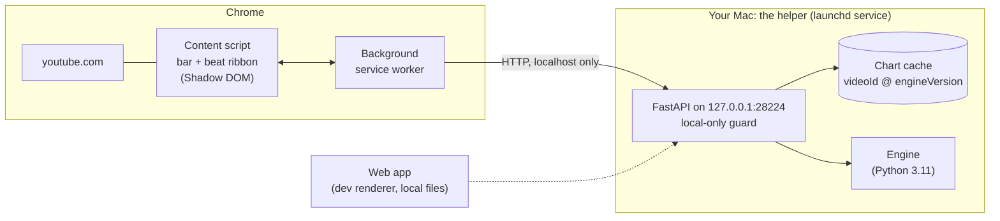
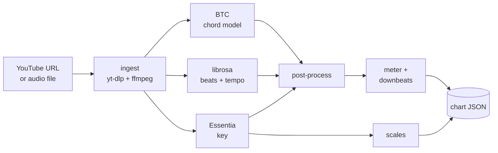

# How tabIt works

tabIt has two halves: a **Chrome extension** that draws the chords under a YouTube
video, and a **helper** that runs on your own Mac and does the actual analysis. Nothing
is computed in the cloud.

## The pieces



| Piece | What it does |
|---|---|
| **Engine** (`engine/`) | Audio in, chart JSON out: chords, key, scales, tempo, beats, meter. Also a CLI. |
| **Helper** (`api/`, `helper/`) | A small FastAPI service around the engine with a disk cache and job queue, managed by launchd and the `tabit` CLI. |
| **Installer** (`packaging/install.sh`) | One command that provisions Python 3.11 (via uv), a pinned static ffmpeg, the chord model, and the launchd service. |
| **Chrome extension** (`extension/`) | The bar and beat ribbon under the video. Talks only to the helper and to youtube.com. |
| **Web app** (`web/`) | A second renderer of the same chart JSON. It is the only way to analyze a **local audio file** (up to 100 MB), and shows the whole song as a per-beat chord grid. |

The **chart JSON** is the contract between them: the extension and the web app are both
just renderers of it.

## What happens when you click "Get chords"

1. The content script asks the background worker for the chart of the current video.
2. The worker asks the helper for it (`GET /chart/{videoId}`). If the same song was
   analyzed before with the same engine version, it comes straight from the disk cache.
3. Otherwise the worker submits a job (`POST /analyze`) and polls it. The helper reports
   its progress, which the bar shows as three steps: **Fetch audio**, **Find chords**,
   **Build chart**.
4. The finished chart is cached on disk and kept for the browser session. The ribbon follows
   the video's clock: the current chord, the next one before it arrives, and the key,
   tempo and scales that fit. It pauses with ads, and survives YouTube's in-page
   navigation.

If the helper isn't running, the bar says so and reconnects by itself once it is back.

## The engine



- **Ingest** downloads the audio (or reads your file) and converts it to a wav.
- **Chords** come from BTC alone, reading the original mix. Key detection and beat tracking
  run alongside it.
- **Post-processing** snaps chord changes to the beat grid and merges neighbours. It lowers
  the confidence of chords whose root is outside the detected key (they show softer in the
  UI), then simplifies low-confidence exotic chords to plain triads. Chord segments under
  half a second are dropped by the model wrapper before any of this.
- **Meter** is inferred from where chord changes land relative to the beat grid, so the
  chart gets real bar lines instead of assuming 4/4.
- BTC emits no slash chords, so every chord's bass is its root.

## Honest about accuracy

This is a portfolio and learning project, and it doesn't pretend otherwise. Chord
detection is imperfect, so tabIt shows its uncertainty instead of hiding it: chords the
model is unsure about (confidence under 0.75, or outside the detected key) are drawn
visibly softer, never removed. In the web app you can click a chord to correct it, and the
edit is kept locally. The extension doesn't edit.

**Measured result.** On a pilot sample of 11 Beatles songs (hand-labeled
[Isophonics](http://isophonics.net/) annotations, scored with `mir_eval` against the live
YouTube pipeline), the shipped engine (0.5.1, BTC only) scores:

| | majmin | sevenths | root |
|---|---:|---:|---:|
| Duration-weighted, all 11 songs | **0.79** | **0.74** | **0.79** |

Per song, majmin ranges from 0.48 (*A Hard Day's Night*) to 0.90 (*Eleanor Rigby*); the full
table is in [`benchmarks/results/latest.md`](../benchmarks/results/latest.md) and the method
in [`benchmarks/README.md`](../benchmarks/README.md). For comparison, the retired
Demucs + crema engine (0.2.1) scored 0.75 majmin / 0.65 sevenths on the same songs.

**What this does and doesn't tell you.** Eleven songs from one artist and era is a pilot,
not a claim about accuracy across genres or recordings. The annotations are timed to
studio masters, so an upload that is a remaster or a different edit can lose points that the
engine didn't earn. Treat the number as a directional signal, not a spec.

## Privacy and safety

- There are no accounts, no analytics and no tracking, and nothing is sent to the developer.
  [`PRIVACY.md`](../PRIVACY.md) has the full policy.
- The helper listens on `127.0.0.1` only. A guard in front of it rejects any request whose
  `Host` is not a loopback name (against DNS rebinding) and any cross-site write that does
  not come from the Chrome extension or the local dev web app.
- The only network traffic is the helper downloading the audio of a video you asked about
  (from YouTube), and, at install time, the tools and model it needs (GitHub, PyPI, astral.sh).

## Chord recognition and credits

Chords are recognized by **BTC**, the Bi-directional Transformer for Chord Recognition
by Park et al. (ISMIR 2019), <https://github.com/jayg996/BTC-ISMIR19>. Its code (MIT,
© 2019 Jonggwon Park) is vendored, trimmed to inference, in
[`engine/vendor/btc`](../engine/vendor/btc) with the upstream licence and a notice.

The pretrained weights are by the authors. They are not in this repository: they are
downloaded at first use from the authors' repo at a pinned commit, verified against a
pinned SHA-256, and stored under `~/Library/Application Support/tabIt/models` (override
with `TABIT_MODELS_DIR`). The authors state no licence for the weights, which were trained
on commercial recordings, so their terms for commercial use are unconfirmed; **tabIt is
non-commercial**. If the weights can't be fetched, analysis fails with a message naming the
models folder and the pinned URL, and `tabit warmup` (or just retrying) picks up again.
There is no fallback model.

```bibtex
@inproceedings{park2019bi,
  title={A Bi-directional Transformer for Musical Chord Recognition},
  author={Park, Jonggwon and Choi, Kyoyun and Jeon, Sungwook and Kim, Dokyun and Park, Jonghun},
  booktitle={Proceedings of the 20th International Society for Music Information Retrieval Conference (ISMIR)},
  address={Delft, The Netherlands},
  year={2019},
  eprint={1907.02698},
  archivePrefix={arXiv},
  url={https://arxiv.org/abs/1907.02698}
}
```

Also built with:

| | |
|---|---|
| [PyTorch](https://pytorch.org) | runs the BTC model |
| [librosa](https://librosa.org) | beat and tempo tracking |
| [Essentia](https://essentia.upf.edu) | key detection |
| [yt-dlp](https://github.com/yt-dlp/yt-dlp) and [FFmpeg](https://ffmpeg.org) | fetching and decoding audio |
| [uv](https://docs.astral.sh/uv/) | provisions Python in the installer |
| [mir_eval](https://github.com/mir-evaluation/mir_eval) | the accuracy harness |
| [FastAPI](https://fastapi.tiangolo.com), [React 19](https://react.dev), [Vite](https://vite.dev), [esbuild](https://esbuild.github.io) | the helper, web app and extension |

The accuracy benchmark scores against the
[Isophonics](http://isophonics.net/) Beatles chord annotations (© Centre for Digital Music,
Queen Mary University of London); see [`benchmarks/README.md`](../benchmarks/README.md).

## Older versions

Release v0.3.1 and earlier ran Demucs source separation, then crema (McFee & Bello,
"Structured training for large-vocabulary chord recognition", ISMIR 2017) on the harmonic
mix and CREPE on the bass stem. That gave slash chords like `A/C#` at the cost of a ~2 GB
install and ~30 s per song. To keep that pipeline, install the pinned tag:

```bash
curl -fsSL https://raw.githubusercontent.com/paolosand/tabIt/v0.3.1/packaging/install.sh | TABIT_REF=v0.3.1 sh
```

## Where it's going

Shipped: engine, helper and one-line installer, extension, web app, redesign, and the
Chrome Web Store submission (v0.5.1, in review).

Next:
- Chrome Web Store listing approved.
- A signed menubar app with guided setup, so installing needs no Terminal. This is
  deliberately deferred past the first public release.

Known engine limits: tempo can double on slow or drum-less tracks, there are no slash
chords since v0.4.0, and accuracy has only been measured on one artist and era. The longer
planning notes are in [`BETA_ROADMAP.md`](BETA_ROADMAP.md) and the per-task build ledger is
in [`PROGRESS.md`](PROGRESS.md).
